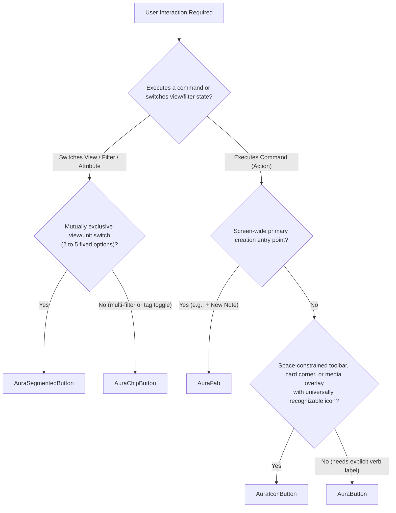

# 00 · Actions & Button Selection Principles

## 1. Purpose

Defines the **5-type Action Component Taxonomy** and the **Usage & Selection Principles** governing when each button type and visual variant should be used across Aura-powered applications:

- **My Planner:** Daily/weekly/monthly schedule management and paper-like diary writing
- **My Finance:** Real estate, stocks, savings, and asset/transaction tracking
- **My Drink Diary:** Wine and whiskey tasting notes, bottle photo archive, and search
- **Home Launcher:** Android launcher with icons, widgets, wallpapers, and 3D visual effects

---

## 2. Action Component Taxonomy

| Component | Role | Representative Usage Across Target Apps |
|---|---|---|
| `AuraButton` | Explicit action with a clear verb label (+ optional leading/trailing icons) | Save schedule (**Planner**), Record buy/sell (**Finance**), Save tasting note (**Drink Diary**), Apply launcher layout (**Launcher**) |
| `AuraIconButton` | Compact icon-only action with mandatory accessible description | Search/Today jump in top bar (**Planner**), Favorite/Share over bottle photo (**Drink Diary**), Edit widget/effect controls (**Launcher**) |
| `AuraFab` | Persistent floating entry point for the single primary creation task on a screen | `+ New Event/Diary` (**Planner**), `+ Add Asset/Transaction` (**Finance**), `+ Log Bottle/Note` (**Drink Diary**) |
| `AuraSegmentedButton` | Immediate, mutually exclusive view mode or unit switcher (2–5 options) | `Day \| Week \| Month` (**Planner**), `1W \| 1M \| 1Y` or `KRW \| USD` (**Finance**), `All \| Wine \| Whiskey` (**Drink Diary**), `Icons \| Widgets \| 3D` (**Launcher**) |
| `AuraChipButton` | Lightweight capsule toggle or inline contextual filter/attribute action | Tasting aroma/flavor tags (**Drink Diary**), Asset class filters (**Finance**), Calendar category tags (**Planner**) |

---

## 3. Principle 1: Intent Decision Tree

Never choose a button based purely on visual appearance. Select the component from the user's task intent:

### Selection Summary

| Component | When to Use | When NOT to Use |
|---|---|---|
| `AuraButton` | Submitting forms, confirming dialogs, navigating steps, or any action requiring an explicit verb label (`Save`, `Confirm`, `Add Asset`) | Icon-only actions without a label (`AuraIconButton`), multi-select tags (`AuraChipButton`) |
| `AuraIconButton` | Toolbars, card headers, photo/wallpaper overlays where space is tight and icon meaning is unambiguous (`Close`, `Search`, `Share`, `Bookmark`) | Ambiguous actions that require text to understand; primary form submission |
| `AuraFab` | The single most frequent creation action on a browse/list screen, remaining accessible while scrolling | Destructive actions, secondary settings, or placing 2+ FABs on the same screen |
| `AuraSegmentedButton` | Switching the representation or unit of the **current** screen immediately without pressing Save | Top-level app navigation (`NavigationBar` / `TabBar`), or > 5 dynamic options (`AuraChipButton` / Dropdown) |
| `AuraChipButton` | Selecting tasting notes (`Oak`, `Vanilla`, `Peat`), filtering asset categories, or compact inline toggles | Final form submission or bottom sticky Call-to-Action (CTA) |

---

## 4. Principle 2: Visual Hierarchy & One-Primary Rule

`AuraButton` variants follow a strict visual weight hierarchy:

$$\text{Primary} \succ \text{Destructive (Solid)} \succ \text{Secondary (Tonal)} \succ \text{Outline} \succ \text{Ghost}$$

- **`BTN-RULE-001` (One Primary Per Context):** A single screen, dialog, or bottom sheet may contain **at most one `Primary` button** representing the main forward path.
- **`BTN-RULE-002` (No Primary Inside Repeated Cards/Widgets):** List items, diary cards (**Drink Diary**), schedule blocks (**Planner**), and launcher widgets (**Launcher**) must never contain `Primary` buttons. Use `Secondary`, `Outline`, or `Ghost` inside repeated containers so the screen is not flooded with high-saturation fills.
- **`BTN-RULE-003` (Destructive Escalation):** Irreversible destructive triggers (`Delete Account`, `Reset Layout`) should use `Ghost` or `Outline` at the entry surface, reserving solid `Destructive` exclusively for the final confirmation step inside a dialog or bottom sheet.

---

## 5. Principle 3: Surface Material Adaptation (`Solid` vs. `Glass`)

Aligned with `AuraMaterial` in [00-principles.md](../../foundation/00-principles.md):

- **`Solid` (Default):** Mandatory on solid canvas surfaces (`background.primary`, `surface.default`, `surface.raised`) used across **My Planner** forms and **My Finance** tables.
- **`Glass` / `Floating` (Future `AuraMaterial.Glass`):** Reserved strictly for controls floating over dynamic imagery, wallpapers, or 3D effects—such as **Home Launcher** desktop overlays, **My Drink Diary** bottle photo overlays, or floating calendar toolbars.
- **`BTN-RULE-004` (No Decorative Glass):** Do not use `Glass` buttons inside standard opaque cards or settings forms.

---

## 6. Principle 4: Placement & Pairing Patterns

1. **Two-Button Horizontal Pairing:** Place the secondary/cancel action (`Outline` or `Ghost`) on the **start (left in LTR)** and the primary/confirm action (`Primary` or `Destructive`) on the **end (right in LTR)**.
2. **1:2 Asymmetric Sticky Bottom Bar:** On creation/edit screens (Diary entry, Transaction entry, Tasting note), pair `Outline` Cancel (`weight = 1f`) and `Primary` Save (`weight = 2f`) inside a bottom bar respecting `WindowInsets.ime` and navigation bar insets.
3. **Vertical Stack Fallback:** When labels exceed available single-line width (e.g., long translations or large accessibility font scales), stack `Primary` on top and `Outline`/`Ghost` below with `fullWidth = true`.

---

## 7. Principle 5: Ergonomics & Safety

- **`BTN-RULE-005` (Minimum Touch Target):** Even when visual height is `36px` (`Small`), the interactive hit boundary must remain at least **`48dp × 48dp`** on Android (`44pt × 44pt` on iOS).
- **`BTN-RULE-006` (Duplicate-Click & Loading Safety):** Actions that mutate financial records (**My Finance**) or save media entries (**My Drink Diary**) must prevent accidental double taps via built-in debounce (`400ms` default) and preserve button width when `loading = true` to avoid layout jumps.
