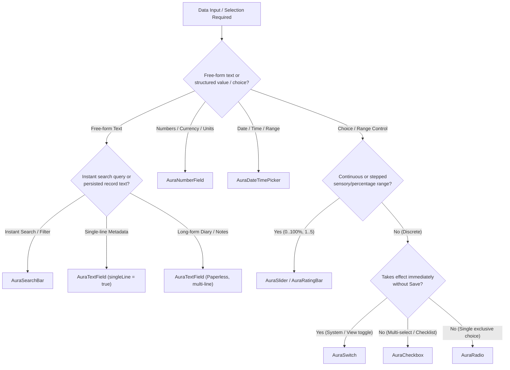

# 00 · Data Input & Selection Principles

## 1. Purpose

Defines the **Data Input & Selection Component Taxonomy** and the **Usage Principles** governing how users enter text, numeric/financial quantities, dates, filters, and sensory evaluations across Aura applications:

- **My Planner:** Schedule titles, locations, time blocks, and long-form paper-like diary writing
- **My Finance:** Asset names, currency amounts (`KRW`/`USD`), stock quantities, interest rates (`%`), and maturity periods
- **My Drink Diary:** Bottle names, vintage years, ABV (`%`), volume (`ml`), tasting notes, sensory profiles, and archive search
- **Home Launcher:** App/widget discovery search (`Glass` surface), grid settings, and 3D parallax / blur intensity controls

---

## 2. Input & Selection Component Taxonomy

| Component | Role | Representative Usage Across Target Apps |
|---|---|---|
| `AuraTextField` | Single-line metadata or multi-line reflective text entry (`Outlined`, `Filled`, `Paperless`) | Schedule title & diary entry (**Planner**), Asset name (**Finance**), Tasting notes (**Drink Diary**) |
| `AuraNumberField` | Structured numeric/currency input with formatted grouping, unit affixes, and optional steppers | Asset value, stock price, interest rate (**Finance**), Vintage year, ABV %, price, volume ml (**Drink Diary**) |
| `AuraSearchBar` | Real-time query bar for filtering archives or launching apps (`Solid` & `Glass` material) | Wine/whiskey archive search (**Drink Diary**), Diary/schedule search (**Planner**), Universal app search (**Launcher**) |
| `AuraDateTimePicker` | Temporal selection for dates, times, vintage years, and date ranges | Schedule start/end (**Planner**), Transaction & maturity dates (**Finance**), Tasting date (**Drink Diary**) |
| `AuraSwitch` | Immediate boolean setting toggle with instant effect (no Save button) | 3D parallax effect toggle (**Launcher**), All-day schedule toggle (**Planner**) |
| `AuraCheckbox` | Binary completion or 0..N multi-select inside lists and batch edits | Todo checklist (**Planner**), Multi-asset batch selection (**Finance**) |
| `AuraRadio` | Mutually exclusive single selection from 2–5 descriptive options | Base currency selection (**Finance**), Home grid layout `4×5 / 5×5` (**Launcher**) |
| `AuraSlider` | Continuous or stepped range value adjustment | Blur & 3D depth (**Launcher**), Tasting profile `Body / Tannin / Acidity / Peat` (**Drink Diary**), Target allocation % (**Finance**) |
| `AuraRatingBar` | Discrete star / half-star sensory satisfaction rating | Wine & whiskey enjoyment score (**Drink Diary**) |

---

## 3. Principle 1: Intent Decision Tree

Choose the input control based on **data structure**, **cardinality**, and **commit timing**:

---

## 4. Principle 2: Container Variant Selection (`Outlined` vs. `Filled` vs. `Paperless`)

- **`INP-RULE-001` (Match Container Weight to Task Mode):**
  - **`Outlined`:** Use for structured forms where clear field boundaries and labels are essential (**My Finance** asset registration, **My Planner** event metadata).
  - **`Filled`:** Use on high-contrast white/raised cards (`surface.default`) for compact metadata inputs with soft separation (`surface.sunken`).
  - **`Paperless`:** Use exclusively for long-form, calm, distraction-free writing surfaces—such as **My Planner** daily diary pages and **My Drink Diary** tasting notes—where heavy rectangular borders disrupt reading and writing flow.

---

## 5. Principle 3: Immediate Effect vs. Form Submission (`Switch` vs. `Checkbox` / `Radio`)

- **`INP-RULE-002` (Commit Semantics):**
  - Use **`AuraSwitch`** only when flipping the toggle applies immediately without requiring a separate Save/Confirm button (e.g., enabling 3D wallpaper depth in **Home Launcher**).
  - Use **`AuraCheckbox`** for multi-select options or task completion checklists (**My Planner** todos).
  - Use **`AuraRadio`** for mutually exclusive choices with longer descriptive labels inside a form or bottom sheet. For short 1–2 word immediate view toggles (`Day | Week | Month`), prefer **`AuraSegmentedButton`**.

---

## 6. Principle 4: Structured Numeric & Unit Affixes

- **`INP-RULE-003` (Explicit Unit Clarity):**
  - Numeric and financial inputs must always surface explicit unit prefixes or suffixes (`₩`, `$`, `%`, `ml`, `% ABV`) inside the field chrome (`prefixText` / `suffixText`), never leaving units implied only by placeholder text.
  - When formatted grouping (thousands separators), decimal precision rules, or quick increment buttons are needed, use `AuraNumberField` instead of raw `AuraTextField`.

---

## 7. Principle 5: Validation Stability & Accessibility

- **`INP-RULE-004` (Persistent Accessible Labels):** Every form input must expose a persistent `label` above or attached to the field. Never use `placeholder` as a substitute for `label`, because placeholder text disappears as soon as typing begins.
- **`INP-RULE-005` (Non-Color Error Communication):** Error states must pair error border/underline color (`status.error.solid`) with explicit `errorText` below the input container and platform error semantics (`semantics { error(...) }`) so validation feedback never relies on color alone.
- **Minimum Touch Target:** All interactive inputs and selection controls must provide at least `48dp × 48dp` (`44pt × 44pt` on iOS) hit area.
