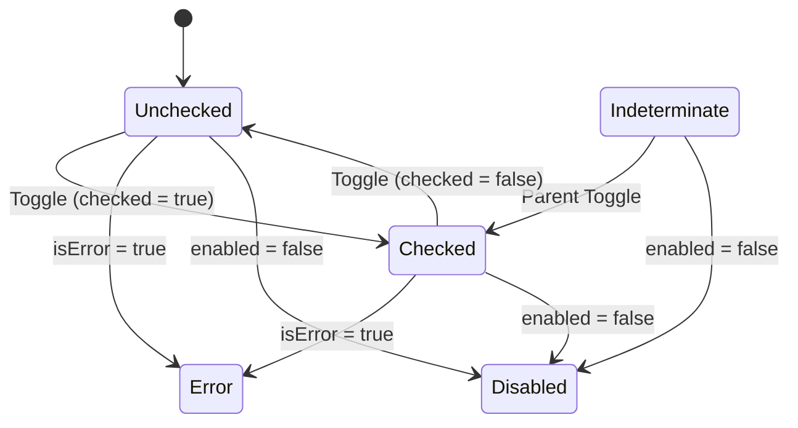

# AuraCheckbox

Discrete selection control supporting `Unchecked`, `Checked`, and `Indeterminate` states for multi-select batch lists, consent checkboxes, and **My Planner** task completion checklists.

## 1. Overview

`AuraCheckbox` renders a precision `20.dp × 20.dp` rounded-square control (`6.dp` corner radius) inside a `>= 48.dp` accessible touch target. It supports parent-child tri-state hierarchies (`Indeterminate` when some items in a group are selected), validation error emphasis (`isError`), and optional task-completion strikethrough (`strikethroughWhenChecked`) for **My Planner** daily checklists.

---

## 2. Intent & Usage Principles

### When to Use

- Selecting zero, one, or multiple independent items from a list (e.g., **My Finance** multi-asset export or **My Drink Diary** batch tag edit).
- A parent "Select All" control whose child items can be partially checked (`indeterminate = true`).
- Task/todo completion rows in **My Planner** (`strikethroughWhenChecked = true`).
- Explicit agreement/acknowledgment inputs inside forms before hitting Save.

### When NOT to Use

- **Instant system or preference toggles:** Settings that apply immediately without form submission should use `AuraSwitch`.
- **Mutually exclusive choices:** Selecting 1 option out of 2–5 choices must use `AuraRadio` or `AuraSegmentedButton`.
- **Compact filter chips in horizontal toolbars:** Use `AuraChipButton(variant = Filter)` instead of vertical checkbox stacks above scrolling lists.

### Usage Rules

- **`CB-RULE-001` (Tri-State Parent Consistency):** When representing a parent group header with mixed child states, pass `indeterminate = true` (which renders a centered horizontal dash inside a filled box and maps to `ToggleableState.Indeterminate`).
- **`CB-RULE-002` (Error Visibility Beyond Color):** When `isError = true`, pair the `status.error.solid` border/fill emphasis with a visible helper/error description or inline error message in the parent form (`INP-RULE-005`).
- **`CB-RULE-003` (Full-Row Hit Expansion):** When `label != null`, bind `triStateToggleable` to the entire labeled row so tapping anywhere on the label text toggles selection comfortably within `>= 48.dp` vertical bounds.

### Do / Don't

| Do | Don't |
|---|---|
| Use `AuraCheckbox` for multi-select item lists and **My Planner** checklists. | Use `AuraCheckbox` for immediate Dark Mode or 3D Parallax toggles (use `AuraSwitch`). |
| Use `indeterminate = true` on "Select All" headers when only a subset is checked. | Force users to guess partial selection by showing an unchecked parent box. |
| Enable `strikethroughWhenChecked = true` on **My Planner** todo items for satisfying completion clarity. | Apply strikethrough on multi-select batch filter items where checked means "active". |
| Maintain `48.dp` minimum hit area around standalone `20.dp` boxes in toolbars/tables. | Shrink clickable bounds tightly to the `20.dp × 20.dp` visual square. |

---

## 3. Anatomy & Variants

```text
  Unchecked:     Checked:       Indeterminate:  Error Unchecked:
  ┌──────┐       ┌──────┐       ┌──────┐        ┌──────┐
  │      │       │  ✓   │       │  ──  │        │      │  (status.error.solid border)
  └──────┘       └──────┘       └──────┘        └──────┘
   20×20dp        brand.primary  brand.primary   2dp stroke
```

- **State Enum (`AuraCheckboxState`):** `Unchecked`, `Checked`, `Indeterminate`.
- **Visual Box Size:** `20.dp × 20.dp`, shape `RoundedCornerShape(6.dp)`, border width `1.75.dp` (`2.dp` on `isError`).
- **Optional Checklist Completion Mode:** Setting `strikethroughWhenChecked = true` renders `label` with `TextDecoration.LineThrough` and muted `content.secondary` once checked (while `indeterminate` keeps normal text decoration).

---

## 4. Token Bindings

| Element | State | Light / Dark Semantic Token |
|---|---|---|
| Box Fill | Checked / Indeterminate (`Enabled`) | `AuraTheme.colors.brand.primary` (or `status.error.solid` if `isError`) |
| Box Fill | Unchecked (`Enabled`) | `AuraTheme.colors.surface.default` (or transparent within row) |
| Box Fill | `Disabled` (Checked / Unchecked) | `AuraTheme.colors.interaction.disabledContainer` |
| Box Border | Unchecked (`Enabled`) | `AuraTheme.colors.border.strong` (`status.error.solid` if `isError`) |
| Box Border | Checked / Indeterminate (`Enabled`) | `AuraTheme.colors.brand.primary` (`status.error.solid` if `isError`) |
| Box Border | `Disabled` | `AuraTheme.colors.content.disabled` |
| Check / Dash Glyph | Checked / Indeterminate (`Enabled`) | `AuraTheme.colors.brand.onPrimary` (`status.error.onSolid` if `isError`) |
| Check / Dash Glyph | `Disabled` | `AuraTheme.colors.content.disabled` |
| `label` Text | Unchecked / Checked+Strikethrough / Disabled | `content.primary` / `content.secondary` / `content.disabled` (`typography.bodyLarge`) |
| `description` Text | `Enabled` / `Disabled` | `content.secondary` / `content.disabled` (`typography.bodySmall`) |

---

## 5. Responsive Layout Behavior

`AuraCheckbox` adapts smoothly across all Aura viewport width and aspect ratio profiles (`AuraWindowInfo`):

| Width / Display Profile | Standalone Box Behavior | Labeled Checklist / Selection Row Behavior |
|---|---|---|
| `ExtraSmall` (`< 360dp`) | Fixed `20.dp` visual box centered inside `48.dp × 48.dp` hit target. | Leading checkbox aligns to top-first-line when `label` wraps onto multiple lines (`12.dp` horizontal gap). |
| `Compact` (`360–599dp`) | Consistent `48.dp` spacing between adjacent checkboxes in table/list rows. | Single-column checklist rows fill available width cleanly with comfortable `12.dp` vertical cadence. |
| `Square` (`~1:1` Multi-window) | Prevents crowding when panes narrow into pop-up floating windows. | Wraps label cleanly without truncating important task titles or legal consent labels. |
| `UltraWide` (`> 21:9`) | Maintains crisp leading edge alignment in compact list cards. | Limits row stretch cleanly via parent pane constraints (`AuraCard` or `AuraAdaptiveTwoPane`). |
| `Expanded` (`>= 840dp` Tablet) | Participates in multi-column asset grids or inspector control panels. | Parent forms can arrange checkboxes in multi-column grids (`AuraAdaptiveGrid`) while retaining full-row `Role.Checkbox` semantics per item. |

---

## 6. State Machine & Interaction Precedence

**State Precedence:** `Disabled` > `Error` > `Pressed` > `Checked` / `Indeterminate` / `Unchecked`.



---

## 7. Motion & Micro-interactions

Consumes `AuraTheme.motion`:

1. **Glyph Pop-In & Draw:** Checkmark stroke and indeterminate bar progress animate from `0f` to `1f` using `AuraTheme.motion.iconSpring()`, giving tactile confirmation when marking a task complete.
2. **Tactile Press Feedback:** Uses `rememberAuraTactilePressed(interactionSource, motion.minPressDurationMillis)` to compress the checkbox visual square to `AuraTheme.motion.pressedScaleDefault` (`0.96f`) via `pressInSpring()` / `pressOutSpring()`, even on rapid taps.
3. **Color Transitions:** Box background and border animate over `AuraTheme.motion.stateChangeDurationMillis` (`150ms`).
4. **Reduced Motion:** Uses `snap()` whenever `ANIMATOR_DURATION_SCALE == 0f`.

---

## 8. Cross-Platform API Contract

<!-- API:ANDROID:BEGIN -->
```kotlin
enum class AuraCheckboxState { Unchecked, Checked, Indeterminate }

@Composable
fun AuraCheckbox(
    checked: Boolean,
    onCheckedChange: ((Boolean) -> Unit)?,
    modifier: Modifier = Modifier,
    indeterminate: Boolean = false,
    enabled: Boolean = true,
    isError: Boolean = false,
    label: String? = null,
    description: String? = null,
    strikethroughWhenChecked: Boolean = false,
)
```
<!-- API:ANDROID:END -->

<!-- API:IOS:BEGIN -->
```swift
public enum AuraCheckboxState: Sendable {
    case unchecked
    case checked
    case indeterminate
}

public struct AuraCheckbox: View {
    public init(
        state: AuraCheckboxState,
        onToggle: (() -> Void)? = nil,
        isEnabled: Bool = true,
        isError: Bool = false,
        label: String? = nil,
        description: String? = nil,
        strikethroughWhenChecked: Bool = false
    )
}
```
<!-- API:IOS:END -->

<!-- API:WEB:BEGIN -->
```ts
export type AuraCheckboxState = 'unchecked' | 'checked' | 'indeterminate';

export interface AuraCheckboxProps {
  checked: boolean;
  onCheckedChange?: (checked: boolean) => void;
  indeterminate?: boolean;
  disabled?: boolean;
  isError?: boolean;
  label?: string;
  description?: string;
  strikethroughWhenChecked?: boolean;
  className?: string;
}
```
<!-- API:WEB:END -->

---

## 9. Accessibility & Test Checklist

- [ ] Registers `Role.Checkbox` and `ToggleableState` (`On`, `Off`, `Indeterminate`) via `Modifier.triStateToggleable`.
- [ ] Minimum `48.dp × 48.dp` interactive hit box is enforced for standalone and labeled rows alike.
- [ ] Checked state draws both filled box AND high-contrast checkmark stroke (never relies on fill color change alone).
- [ ] `strikethroughWhenChecked` updates visual text decoration cleanly without altering screen-reader label text.
