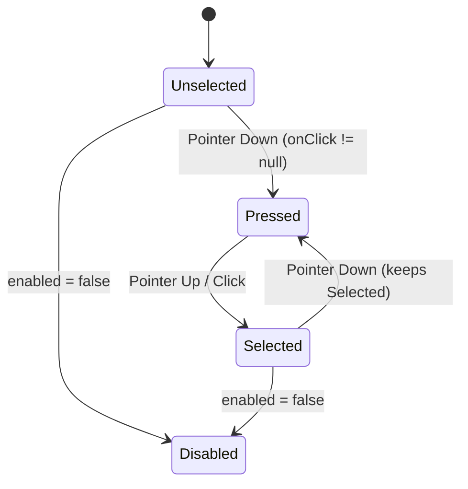

# AuraRadio

Mutually exclusive single-choice selection control for choosing exactly one option from a small list (`2–5` descriptive choices) inside forms, settings sheets, and configuration panels.

## 1. Overview

`AuraRadio` renders a precision `20.dp` circular ring with an animated `10.dp` center indicator dot inside a `>= 48.dp` hit target. It is tailored for descriptive single-selection flows such as **My Finance** base currency (`KRW / USD / EUR`), **Home Launcher** icon grid density (`4×5 / 4×6 / 5×5`), and **My Drink Diary** serving temperature presets.

---

## 2. Intent & Usage Principles

### When to Use

- Picking **exactly 1 option** from `2–5` mutually exclusive items that benefit from descriptive labels or secondary subtext (`description != null`).
- Inside bottom sheets, dialogs, or settings groups enclosed in a `Modifier.selectableGroup()` parent.

### When NOT to Use

- **Multiple simultaneous selections:** Use `AuraCheckbox`.
- **Single binary On/Off toggle:** Never use a single radio button to turn one setting on/off (a selected radio cannot be deselected by tapping it again); use `AuraSwitch` or `AuraCheckbox`.
- **Compact 1–2 word header mode switching (`Day | Week | Month`):** Prefer `AuraSegmentedButton`.
- **Lists exceeding 6–8 items:** Use a searchable picker sheet or `AuraSearchBar` list instead of a tall radio column.

### Usage Rules

- **`RD-RULE-001` (Mutual Exclusion & Default Selection):** Radio groups should always wrap options in `Modifier.selectableGroup()` and pre-select a sensible initial default unless deliberate empty-state validation is required.
- **`RD-RULE-002` (Non-Deselectable Tap Semantics):** Tapping an already selected `AuraRadio` must keep it selected (`Role.RadioButton` `selectable` contract), never toggling back to empty.
- **`RD-RULE-003` (48dp Hit Box & Row Expansion):** Standalone circles guarantee `>= 48.dp` hit bounds; when `label != null`, the full row acts as the selectable container.

### Do / Don't

| Do | Don't |
|---|---|
| Group 2–5 mutually exclusive `AuraRadio` items in a `Column` with `selectableGroup()`. | Render a single standalone `AuraRadio` as a checkbox substitute. |
| Use `description` to explain the impact of choosing a preset (`"4×5 · Balanced dock spacing"`). | Wrap entire multi-paragraph forms inside one radio option row. |
| Use `AuraSegmentedButton` for short horizontal view toggles in headers. | Stack 2–3 word horizontal radio buttons inside a dense app toolbar. |
| Keep unselected ring stroke at `border.strong` so the affordance stays clear in Dark & Light modes. | Hide the outer ring border until selected. |

---

## 3. Anatomy & Variants

```text
  Unselected:     Selected:       Labeled Row Mode:
     ╭───╮           ╭───╮        ╭────────────────────────────────────────╮
    │     │         │  ●  │       │ (●)  Korean Won (KRW)                  │
     ╰───╯           ╰───╯        │      Format amounts with ₩ and comma   │
                                  ╰────────────────────────────────────────╯
   20dp ring     10dp inner dot   >= 48dp hit target row (Role.RadioButton)
```

- **Outer Ring Diameter:** `20.dp`, `2.dp` stroke (`1.75.dp` when unselected).
- **Inner Dot Diameter:** `10.dp` filled circle centered inside the ring, scaling smoothly `0f -> 1f` when selected.

---

## 4. Token Bindings

| Element | State | Light / Dark Semantic Token |
|---|---|---|
| Outer Ring Stroke | Selected (`Enabled`) | `AuraTheme.colors.brand.primary` |
| Outer Ring Stroke | Unselected (`Enabled`) | `AuraTheme.colors.border.strong` |
| Outer Ring Stroke | `Disabled` | `AuraTheme.colors.content.disabled` |
| Outer Ring Interior | Unselected (`Enabled`) | `AuraTheme.colors.surface.default` |
| Outer Ring Interior | `Disabled` | `AuraTheme.colors.interaction.disabledContainer` |
| Inner Dot Fill | Selected (`Enabled`) | `AuraTheme.colors.brand.primary` |
| Inner Dot Fill | Selected (`Disabled`) | `AuraTheme.colors.content.disabled` |
| Press Overlay | `Pressed` | `AuraTheme.colors.interaction.pressedOverlay` |
| `label` Text | `Enabled` / `Disabled` | `AuraTheme.colors.content.primary` / `content.disabled` (`typography.bodyLarge`) |
| `description` Text | `Enabled` / `Disabled` | `AuraTheme.colors.content.secondary` / `content.disabled` (`typography.bodySmall`) |

---

## 5. Responsive Layout Behavior

`AuraRadio` adapts layout geometry cleanly across all Aura viewport width and display profiles (`AuraWindowInfo`):

| Width / Display Profile | Standalone Ring Behavior | Labeled Radio Row Behavior |
|---|---|---|
| `ExtraSmall` (`< 360dp`) | Centered `20.dp` ring inside `48.dp × 48.dp` accessible hit bounds. | Top-aligned indicator stays anchored to the first line of `label` when narrow widths wrap labels onto 2 lines. |
| `Compact` (`360–599dp`) | Vertical radio list fills full column width (`12.dp` horizontal gap between circle and label). | Full-row selectable target with generous `48.dp+` vertical height prevents mis-taps between adjacent rows. |
| `Square` (`~1:1` Multi-window) | Retains full `48.dp` minimum hit bounds inside pop-up floating panels. | Vertical radio options remain scannable even when side-by-side preview panes tighten horizontally. |
| `UltraWide` (`> 21:9`) | Maintains crisp leading alignment inside compact list containers. | Caps horizontal expansion to parent `AuraCard` / pane constraints so labels and descriptions remain cohesive. |
| `Expanded` (`>= 840dp` Tablet) | Displays inside secondary inspector forms or multi-column preference groups. | Pairs cleanly inside `AuraCard` selection containers without drifting apart on wide tablet viewports. |

---

## 6. State Machine & Interaction Precedence

**State Precedence:** `Disabled` > `Pressed` > `Selected` / `Unselected`.



---

## 7. Motion & Micro-interactions

Consumes `AuraTheme.motion`:

1. **Inner Dot Spring Scale:** When `selected` changes (`false <-> true`), the inner `10.dp` dot scales between `0f` and `1f` with `AuraTheme.motion.iconSpring()`, creating a crisp elastic pop without sluggishness.
2. **Tactile Press Feedback:** Uses `rememberAuraTactilePressed(interactionSource, motion.minPressDurationMillis)` to compress the radio visual circle to `AuraTheme.motion.pressedScaleDefault` (`0.96f`) via `pressInSpring()` / `pressOutSpring()`.
3. **Color Transitions:** Ring stroke color and background tint transition over `AuraTheme.motion.stateChangeDurationMillis` (`150ms`).
4. **Reduced Motion:** Uses `snap()` when system animations are disabled (`ANIMATOR_DURATION_SCALE == 0f`).

---

## 8. Cross-Platform API Contract

<!-- API:ANDROID:BEGIN -->
```kotlin
@Composable
fun AuraRadio(
    selected: Boolean,
    onClick: (() -> Unit)?,
    modifier: Modifier = Modifier,
    enabled: Boolean = true,
    label: String? = null,
    description: String? = null,
)
```
<!-- API:ANDROID:END -->

<!-- API:IOS:BEGIN -->
```swift
public struct AuraRadio: View {
    public init(
        isSelected: Bool,
        action: (() -> Void)? = nil,
        isEnabled: Bool = true,
        label: String? = nil,
        description: String? = nil
    )
}
```
<!-- API:IOS:END -->

<!-- API:WEB:BEGIN -->
```ts
export interface AuraRadioProps {
  selected: boolean;
  onSelect?: () => void;
  disabled?: boolean;
  label?: string;
  description?: string;
  name?: string;
  className?: string;
}
```
<!-- API:WEB:END -->

---

## 9. Accessibility & Test Checklist

- [ ] Registers `Role.RadioButton` via `Modifier.selectable(selected = selected, ...)`.
- [ ] Enforces `>= 48.dp` minimum touch height and width on standalone and row modes.
- [ ] Grouping helper in screens applies `Modifier.selectableGroup()` so TalkBack announces `"in list, 1 of N"`.
- [ ] Verified reduced-motion mode sets dot scale immediately without animation lag.
